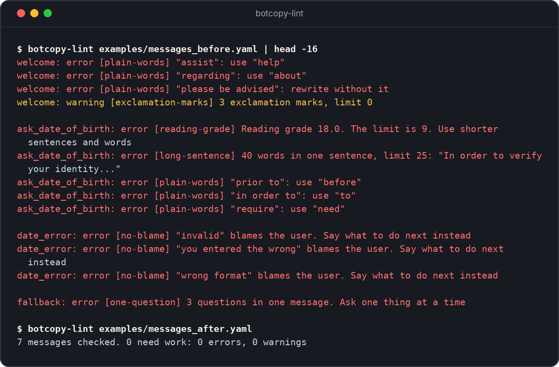

# botcopy-lint

A style checker for chatbot messages.



It reads the messages a bot sends and flags the ones that are hard to read, blame the user or sound cold. It works like a spell checker for tone and plain English.

## The problem it solves

A chatbot can have hundreds of messages written by many people over several years. Style guides exist, but nobody has time to check every message against them by hand. Error messages and fallback messages get the least attention, and they are the ones users see when things go wrong.

This tool checks every message against a style guide in under a second. A team can run it on each change, so new messages meet the guide before they go live.

## Try it

You need Python 3.10 or later.

```bash
git clone https://github.com/Welchlea/botcopy-lint.git
cd botcopy-lint
pip install -e ".[dev]"
```

Check the example messages from before a content review:

```bash
botcopy-lint examples/messages_before.yaml
```

```text
welcome: error [plain-words] "assist": use "help"
welcome: error [plain-words] "regarding": use "about"
welcome: error [plain-words] "please be advised": rewrite without it
welcome: warning [exclamation-marks] 3 exclamation marks, limit 0

ask_date_of_birth: error [reading-grade] Reading grade 18.0. The limit is 9. Use shorter sentences and words
ask_date_of_birth: error [long-sentence] 40 words in one sentence, limit 25: "In order to verify your identity..."
ask_date_of_birth: error [plain-words] "prior to": use "before"
ask_date_of_birth: error [plain-words] "in order to": use "to"
ask_date_of_birth: error [plain-words] "require": use "need"

date_error: error [no-blame] "invalid" blames the user. Say what to do next instead
date_error: error [no-blame] "you entered the wrong" blames the user. Say what to do next instead
date_error: error [no-blame] "wrong format" blames the user. Say what to do next instead

fallback: error [one-question] 3 questions in one message. Ask one thing at a time
fallback: warning [one-apology] 2 apologies in one message. One is enough

payment_delay: error [plain-words] "in due course": give a date or a number of days
payment_delay: warning [cold-wording] "unfortunately" can read as cold or dismissive
payment_delay: warning [cold-wording] "simply" can read as cold or dismissive

warning: error [no-capitals] Words in capitals are harder to read and feel like shouting: NOT, ANYONE, NEVER

more_help: error [plain-words] "additional": use "more or extra"
more_help: error [link-text] Link text "click here" does not say where the link goes

7 messages checked. 7 need work: 16 errors, 4 warnings
```

Check the same messages after the review:

```bash
botcopy-lint examples/messages_after.yaml
```

```text
7 messages checked. 0 need work: 0 errors, 0 warnings
```

## Before and after

| Message | Before | After |
| --- | --- | --- |
| Date error | Invalid date. You entered the wrong format. | I could not read that date. Enter the day, month and year, like 14 3 1975. |
| Payment delay | Unfortunately your payment has been delayed. Simply wait 5 working days and it will arrive in due course. | Your payment is late and I am sorry. It will be in your account by Friday 21 March. You do not need to do anything. |
| Fallback | Sorry, I did not catch that. Apologies. What do you need? Is it about your balance? Or do you want to change your details? | Sorry, I did not catch that. Is your question about your balance, your details or something else? |

## The rules

| Rule | Level | What it flags |
| --- | --- | --- |
| `reading-grade` | Error | The message is above reading grade 9, about age 14 to 15. |
| `long-sentence` | Error | A sentence has more than 25 words. |
| `long-message` | Warning | The message has more than 60 words. |
| `one-question` | Error | The message asks more than one question. |
| `plain-words` | Error | A word on the avoid list, with the plain word to use. |
| `no-blame` | Error | Wording that blames the user, like "invalid". |
| `cold-wording` | Warning | Wording that can read as cold, like "unfortunately". |
| `link-text` | Error | Link text that does not say where it goes, like "click here". |
| `no-capitals` | Error | Whole words in capitals. Known acronyms are allowed. |
| `exclamation-marks` | Warning | Any exclamation mark. |
| `one-apology` | Warning | More than one apology in a message. |

Errors make the command fail. Warnings do not, unless you add `--strict`.

## Use your own style guide

Every limit and word list is in one file: [`default_style.yaml`](src/botcopy_lint/default_style.yaml). To change it, write a file with only the parts you want to change:

```yaml
reading_grade:
  max: 8
avoid_words:
  member: customer
disabled: [exclamation-marks]
```

```bash
botcopy-lint examples/messages_before.yaml --style examples/house_style.yaml
```

Your file is added to the defaults. It does not replace them.

## Message files

Messages can be a YAML file of names and text:

```yaml
messages:
  welcome: Hello. I can help you with your Brightwater pension.
  date_error: I could not read that date. Enter the day, month and year, like 14 3 1975.
```

Or a text file with one message on each line. Findings then show the line number.

Add `--format json` to get results other tools can read.

## Design decisions

- **Every finding says what to do.** "assist: use help" is more useful than "jargon found".
- **Errors and warnings are different.** Reading level and blame are errors because they stop people completing a task. Tone is a warning because it needs a person to judge it.
- **The style guide is a file, not code.** A content team can change the word list without a developer.
- **Short messages are not scored for reading grade.** The formula is not reliable on a few words.
- **Whole words only.** "assist" is flagged. "assistant" is not.

## Limits

- The tool checks wording, not meaning. A message can pass every rule and still be wrong or unhelpful.
- The reading grade is the Flesch-Kincaid formula with an estimated syllable count. Treat it as a guide.
- `cold-wording` will sometimes flag a word that is fine in context. That is why it is a warning.
- It does not replace testing with users.

## Project layout

```text
src/botcopy_lint/
  default_style.yaml   the style guide
  rules.py             the rules
  checker.py           loads messages and style, runs the rules
  readability.py       reading grade and sentence length
  cli.py               the command line
examples/              messages before and after a review, plus a custom style
tests/                 19 automated tests
```

Run the tests with `pytest`.

## About the example

Brightwater Pensions is made up. No real customer data, client content or company material is used anywhere in this project.

Built with AI pair programming.

## Licence

MIT
